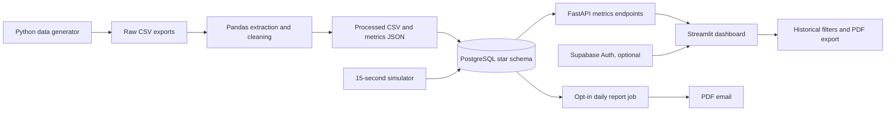

# Assembly Line Data Pipeline

I built this project to practice an end-to-end data engineering workflow using a simulated vehicle assembly line. It generates intentionally imperfect machine exports, cleans and analyzes them, stores events in PostgreSQL, and presents production and quality metrics in a Streamlit dashboard.

I chose an assembly-line scenario because I’m interested in manufacturing data engineering, including the data quality and reporting needs behind a production dashboard. The event stream is synthetic; it is not connected to Tesla, factory equipment, or a public live production feed.

**Hosted dashboard:** [Open the Streamlit app](https://dashboardpy-ccqdte4aobbtrah4pw3u6z.streamlit.app/)

**Repository:** [satkmsk9618/assembly-line-data-pipeline](https://github.com/satkmsk9618/assembly-line-data-pipeline)

## What it does

- Generates station, defect, and downtime records, including duplicates, missing timestamps, shuffled events, and invalid cycle times.
- Uses Pandas to parse timestamps, remove duplicate events, reject unusable rows, calculate cycle time, and produce a run audit.
- Loads cleaned records into a PostgreSQL dimensional model and retains historical records across loads.
- Exposes summary, trend, station, quality, and downtime metrics through FastAPI.
- Displays throughput, cycle time against an 8-minute takt target, station performance, rework, defects, and downtime in Streamlit.
- Supports date-filtered history, optional Supabase email/password sign-in, downloadable PDF reports, and opt-in daily report emails.

## Why I built it for manufacturing data engineering

This project gives me a practical way to work through several tasks that matter in a manufacturing data team: moving event data through an ETL process, checking and cleaning imperfect records, querying a relational model, and explaining operational metrics in a dashboard. It is a personal portfolio project using simulated data, not work performed for Tesla or a production factory.

| Internship focus | What this project demonstrates |
|---|---|
| ETL and data preparation | A repeatable Python/Pandas flow generates raw exports, cleans station events, calculates metrics, and loads PostgreSQL. |
| SQL and relational data | PostgreSQL facts and dimensions, analytical query examples, date-filtered history, and a documented `EXPLAIN ANALYZE` exercise. |
| Data quality | The generator includes duplicates, missing timestamps, shuffled rows, and invalid cycle times. The transform removes duplicates, rejects invalid station events, and reports row counts. |
| Dashboards and documentation | Streamlit views surface takt misses, cycle time, rework, defects, and downtime. The repository documents the data model, dashboard, setup, and data flow. |
| Backend and frontend | FastAPI serves dashboard metrics; Streamlit provides the interactive user interface. |
| Version control and automated checks | GitHub hosts the code; pytest and GitHub Actions provide repeatable checks. I track tasks in a GitHub Project board, which is currently private. |

The role also mentions monitoring and troubleshooting. This repository has pipeline audit counts, application logging, an API health endpoint, and automated tests, but it does **not** currently include a Splunk deployment, freshness or volume anomaly alerts, or a full production-grade validation-monitoring layer. Splunk, an evaluated prompt-driven query assistant, and Jira/Confluence workflows are possible next steps; the current planning and documentation live in GitHub Projects and `/docs`. A standalone repository also cannot demonstrate cross-functional teamwork or participation in another team's code reviews, so I describe those as skills to develop rather than claiming them here.

## How the pieces fit together



The batch ETL path makes it possible to inspect raw and cleaned files. The simulator provides a continuing sample stream for the dashboard. In the local Compose setup, a separate simulator service writes to PostgreSQL every 15 seconds. In the hosted app, when `DATABASE_URL` is configured, a background simulator saves new records to PostgreSQL every 15 seconds while the app is active. Dashboard auto-refresh is off by default to keep the page available while you review it; use **Refresh dashboard now** to load the latest database values, or turn on the optional 15-second dashboard refresh.

PostgreSQL is the history store. The dashboard’s Historical view queries that stored data for a selected date range. History begins accumulating after a database connection is configured; session-only preview events are not backfilled into PostgreSQL.

## Technologies

| Area | Tools | How I use them |
|---|---|---|
| Data generation and ETL | Python, Pandas | Generate repeatable CSV exports, clean event records, calculate metrics, and report rejected/duplicate counts. |
| Storage and modeling | PostgreSQL, SQL | Store station events and related dimensions/facts, preserve history, and support analytical queries. |
| API | FastAPI, Uvicorn | Provide health and dashboard metric endpoints backed by PostgreSQL. |
| Dashboard | Streamlit, Altair | Build the interactive line, quality, station, and downtime views. |
| Reports and accounts | ReportLab, Supabase Auth | Create PDF summaries and optionally authenticate users for report preferences. |
| Local environment | Docker Compose | Start PostgreSQL, the API, simulator, and dashboard together. |
| Quality checks | pytest, GitHub Actions | Run unit tests locally and automatically on pushes and pull requests. |

## Run locally

### Requirements

- Git
- Docker Desktop with Docker Compose
- Python 3.11 or newer for the CLI and tests

### Start the dashboard stack

Run these commands from a terminal. Keep the terminal in the cloned repository directory:

```bash
git clone https://github.com/satkmsk9618/assembly-line-data-pipeline.git
cd assembly-line-data-pipeline
cp .env.example .env
docker compose up --build -d
```

Wait for the services to start, then open:

- Dashboard: <http://localhost:8501>
- FastAPI interactive docs: <http://localhost:8000/docs>
- PostgreSQL: `localhost:5433` (the Compose port; the container listens on 5432)

The first database start applies `sql/schema.sql`. The local simulator begins adding synthetic records every 15 seconds. Dashboard auto-refresh starts paused; click **Refresh dashboard now** when you want to query the newest rows. Turn on **Auto-refresh every 15 seconds** if you want the visible dashboard to refresh itself.

### Run the batch ETL

The batch CLI generates a reproducible sample, cleans it, and loads it into the PostgreSQL database. In a second terminal opened at the repository root, create a Python environment and install the project:

```bash
python3 -m venv .venv
source .venv/bin/activate
python -m pip install -e '.[dashboard,dev]'
assembly-line generate --vehicles 1000 --seed 7
assembly-line run
assembly-line load
```

On Windows PowerShell, activate the environment with `.\.venv\Scripts\Activate.ps1`. The generator writes to `data/raw/`; the cleaning step writes cleaned files and `metrics.json` under `data/processed/`. These generated data files are ignored by Git so each person can create their own sample.

The loader appends records and skips event keys it has already loaded. To stop the local services, run `docker compose down`. To remove the local database and its stored history as well, run `docker compose down -v`.

## Hosted Streamlit setup

The public demo can run in session-only preview mode without PostgreSQL. To enable persistent history, configure the app’s private Streamlit secrets with a PostgreSQL `DATABASE_URL` (Supabase PostgreSQL works). Leave `API_URL` unset for the hosted database mode. Run `sql/schema.sql` in the database before connecting it.

Optional login uses `SUPABASE_URL` and `SUPABASE_ANON_KEY`. Do not put the database password, Supabase service-role key, or SMTP password in this README or commit them to Git. Keep private values in Streamlit secrets or GitHub Actions secrets. Follow [the account, history, and daily report guide](docs/daily-report.md) for the full setup.

To deploy or update the dashboard, connect this repository to [Streamlit Community Cloud](https://share.streamlit.io/) and choose branch `main` and main file `src/assembly_line/dashboard.py`. New commits to `main` are then available for the app to deploy.

## Data model and metrics

The main fact tables store station events, quality defects, and downtime. Dimension tables describe stations, shifts, and defect types. See [`sql/schema.sql`](sql/schema.sql) and the [data dictionary](docs/data-dictionary.md) for column details.

- **Cycle time:** `end_ts - start_ts`, in minutes for one station event.
- **Takt deviation:** event cycle time minus the configured target, which defaults to 8 minutes. A positive deviation means the event took longer than target.
- **First-pass yield:** vehicles with complete records at all observed stations and no rework, divided by the vehicles in scope.
- **Station to investigate:** a screening indicator based on station cycle-time and over-takt counts. It points to a place to investigate; it does not prove a production bottleneck.
- **OEE-style quality proxy:** the current quality percentage uses first-pass yield. Full OEE is not claimed because the simulator does not provide all scheduled-time and ideal-rate inputs needed for availability and performance.

## SQL, testing, and documentation

[`sql/analytics.sql`](sql/analytics.sql) contains analytical query examples, including aggregations and window-function patterns. The measurement guide in [`docs/sql-performance.md`](docs/sql-performance.md) explains how to compare plans with `EXPLAIN (ANALYZE, BUFFERS)`. I have not claimed a query speedup without recording a reproducible benchmark.

Run the test suite with:

```bash
pytest
```

GitHub Actions runs the tests on pushes and pull requests. Project notes include the [architecture](docs/architecture.md), [dashboard guide](docs/dashboard.md), [data dictionary](docs/data-dictionary.md), [troubleshooting notes](docs/version-1-troubleshooting.md), and [project board](docs/project-board.md).

## Trade-offs and next steps

I chose Pandas and Streamlit to keep the transformation and dashboard code understandable while still using production-relevant tools. PostgreSQL provides a real store for history, while Docker Compose makes the local services easier to start together. The simulated records make the project self-contained but cannot represent every behavior of real manufacturing data.

The current dataset is small, so indexes and partitioning are learning exercises rather than evidence of high-volume performance. A next step is to generate a larger benchmark dataset and record query plans and timings. Other improvements include adding a quarantine table for rejected records, expanding shift/station filters, and calculating full OEE once the required source fields exist.
