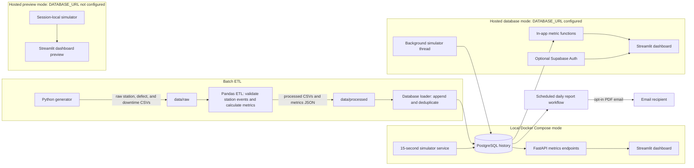

# Architecture and data flow

## Why these components?

- **Generator:** creates repeatable fake machine exports without external data access.
- **Pandas transform:** exposes the cleaning rules in a familiar table-oriented style. Station events get duplicate, timestamp, and cycle-time checks. Defect and downtime CSVs currently receive less validation.
- **PostgreSQL:** stores facts separately from descriptive dimensions and runs analytical SQL.
- **FastAPI:** gives the local Compose dashboard a small metrics API. In hosted database mode, Streamlit calls the same metric functions in-process instead of making a network request to FastAPI.
- **Streamlit:** provides a quick visual layer without needing a separate JavaScript frontend.

The batch ETL and live simulator are separate implemented ingestion paths. The batch path generates CSV exports, validates station events, writes processed files, and loads PostgreSQL. Defect and downtime files are loaded with less validation. The Docker Compose simulator service and hosted background simulator thread write synthetic records directly to PostgreSQL every 15 seconds. The hosted preview simulator is a separate no-database mode, and its session-local events are not persistent. Local Docker Compose and hosted database mode are alternative run configurations. The dashboard can select stored history or filter past dates when PostgreSQL is configured. Recent-window auto-refresh is paused by default, and the All time view refreshes automatically every 15 seconds.

Daily email is opt-in per signed-in account. An hourly GitHub Actions run checks each saved time zone and send hour, summarizes the prior local calendar day from PostgreSQL, and attaches a PDF. The generated report does not invent a data sample when the database has no records.

I looked for a public live source before adding the simulator. I found a [public OPC UA test server with simulated bottling-line values](https://www.sondahub.com/opc-ua-test-server/), but it does not provide vehicle-assembly events with this project's defect and downtime fields. I kept the demo stream inside this repository so the schema stays consistent and the project can run without depending on an outside server.
