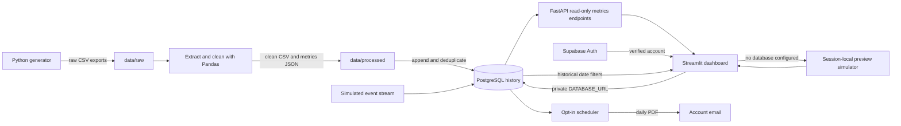

# Architecture and data flow

## Why these components?

- **Generator:** creates repeatable fake machine exports without external data access.
- **Pandas transform:** exposes the cleaning rules in a familiar table-oriented style.
- **PostgreSQL:** stores facts separately from descriptive dimensions and runs analytical SQL.
- **FastAPI:** keeps database access out of the dashboard and gives the UI a small API contract.
- **Streamlit:** provides a quick visual layer without needing a separate JavaScript frontend.

The batch ETL is still available so I can inspect raw and processed CSV files. Docker Compose starts a simulator that appends vehicle events to PostgreSQL every 15 seconds. Dashboard auto-refresh is paused by default; users can refresh manually or enable a 15-second view refresh. The hosted Streamlit preview keeps session-local events if no database is configured. When a private PostgreSQL URL is configured in Streamlit secrets, one shared simulator state is written to PostgreSQL and the dashboard can select all stored history or filter past dates. Supabase Auth provides optional email/password and Google sign-in, while the server-side database connection remains private.

Daily email is opt-in per signed-in account. An hourly GitHub Actions run checks each saved time zone and send hour, summarizes the prior local calendar day from PostgreSQL, and attaches a PDF. The generated report does not invent a data sample when the database has no records.

I looked for a public live source before adding the simulator. I found a [public OPC UA test server with simulated bottling-line values](https://www.sondahub.com/opc-ua-test-server/), but it does not provide vehicle-assembly events with this project's defect and downtime fields. I kept the demo stream inside this repository so the schema stays consistent and the project can run without depending on an outside server.
