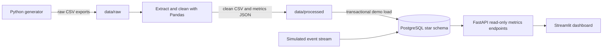

# Architecture and data flow

## Why these components?

- **Generator:** creates repeatable fake machine exports without external data access.
- **Pandas transform:** exposes the cleaning rules in a familiar table-oriented style.
- **PostgreSQL:** stores facts separately from descriptive dimensions and runs analytical SQL.
- **FastAPI:** keeps database access out of the dashboard and gives the UI a small API contract.
- **Streamlit:** provides a quick visual layer without needing a separate JavaScript frontend.

The batch ETL is still available so I can inspect raw and processed CSV files. Docker Compose also starts a small simulator that appends a new simulated vehicle's station events every 15 seconds. The dashboard refreshes at the same interval. This gives the dashboard fresh activity to monitor, but it is not connected to a real factory or machine. The database, API, dashboard, and simulator run together in Compose.

I looked for a public live source before adding the simulator. I found a [public OPC UA test server with simulated bottling-line values](https://www.sondahub.com/opc-ua-test-server/), but it does not provide vehicle-assembly events with this project's defect and downtime fields. I kept the demo stream inside this repository so the schema stays consistent and the project can run without depending on an outside server.
